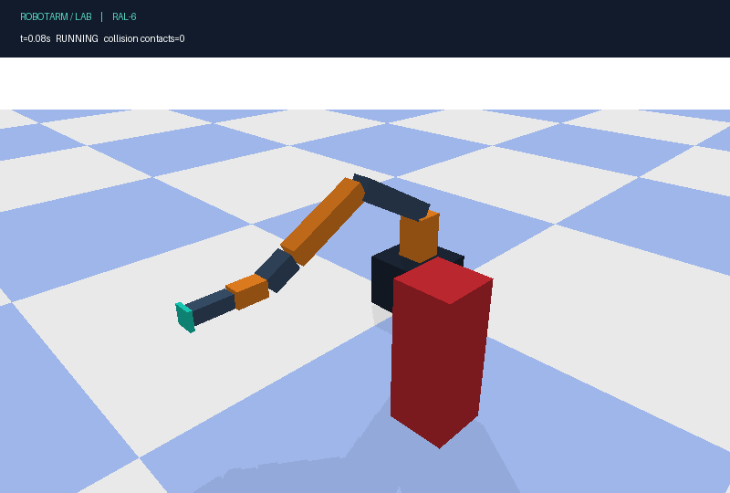
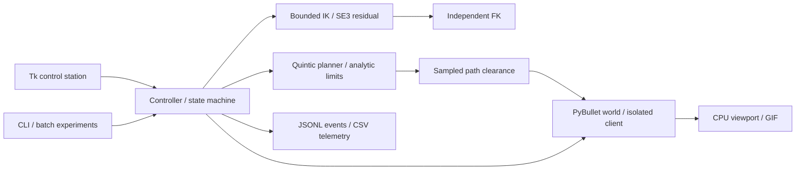

# RobotArm-Lab

An inspectable six-axis robot control laboratory: independent forward kinematics,
bounded numerical inverse kinematics, synchronized quintic trajectories, transactional
collision rejection, and a desktop control station. Built for engineering study and a
public software portfolio.



**Scope:** an original industrial-style RAL-6 arm in **kinematic simulation**. PyBullet
provides collision geometry and rendering. Motion follows position references exactly;
this is not torque control, a hardware driver, or a physically validated robot model.
Simulation checks are not functional-safety certification.

## Quick start — Windows / Python 3.12

Use a local checkout such as `E:\GitHubProjects\RobotArm-Lab`. Install CPython 3.12
with Tcl/Tk. PyBullet 3.2.7 has no official Windows wheel for this interpreter, so its
first install requires **Visual Studio 2022 Build Tools**, the **Desktop development
with C++** workload, and a Windows SDK. Source builds and USB-disk installation can
take several minutes. No global Python packages are changed.

```powershell
cd E:\GitHubProjects\RobotArm-Lab
New-Item -ItemType Directory -Force .tmp, .cache\pip | Out-Null
$env:TEMP = "$PWD\.tmp"
$env:TMP = $env:TEMP
$env:PIP_CACHE_DIR = "$PWD\.cache\pip"
py -3.12 -m venv .venv
.\.venv\Scripts\python.exe -m pip install -r requirements-lock.txt
.\.venv\Scripts\python.exe -m pip install --no-deps --no-build-isolation -e .
.\.venv\Scripts\python.exe -m robotarm_lab gui
```

Keep using the `.venv` interpreter; activation and execution-policy changes are not
required. All generated output defaults to `outputs/` inside the current directory.
The bootstrap helper `scripts/bootstrap.ps1` performs these same local setup steps.
For Linux, Python 3.11 has an upstream PyBullet wheel; install Tk separately for the GUI
(`python3-tk` on Debian/Ubuntu), then use `.venv/bin/python` with the same module commands.

## Run, test, reproduce

```powershell
.\.venv\Scripts\python.exe -m robotarm_lab demo --output outputs\demo
.\.venv\Scripts\python.exe -m pytest --cov=robotarm_lab --cov-report=term-missing --junitxml=outputs\pytest.xml
.\.venv\Scripts\python.exe -m ruff check .
.\.venv\Scripts\python.exe -m ruff format --check .
.\.venv\Scripts\python.exe -m robotarm_lab benchmark --protocol acceptance.json --output outputs\benchmark
.\.venv\Scripts\python.exe -m build --no-isolation
```

The benchmark exits with status 1 on any failed acceptance gate. The full fixed-seed
case records, dependency versions, source digest, protocol digest, and timing results
are saved in JSON; no failed attempts are discarded. The committed
[experiment report](reports/verified/report.md) and [validation notes](docs/VALIDATION.md)
distinguish measured behavior from untested environments. Acceptance thresholds were
committed before the first validation run; `acceptance.json` is the source of truth.

## Operate the station

1. Set joint sliders in degrees, then select **Execute joint target**. Sliders define
   targets; they do not teleport the robot. The API uses radians and SI units.
2. Or enter world-frame TCP X/Y/Z (metres) and extrinsic XYZ roll/pitch/yaw (degrees),
   then **Solve IK + execute**. Both position and orientation must pass validation.
3. **Demo** executes a known pose. **Home** plans a checked motion to the home pose.
4. **Add blocker** inserts a box across the demo route. **Clear obstacles** removes
   obstacles. Runtime checks freeze execution if a newly added obstacle blocks motion.
5. **STOP / FREEZE** immediately freezes this simulation. **Reset scene** explicitly
   clears obstacles and resets the simulated arm to Home. Neither represents physical
   stopping or recovery on an actual robot.
6. The bottom panel shows state, joint angles, TCP, speed and simulation time.
   JSONL events are saved in `outputs/gui/session.jsonl`. **Save viewport PNG** saves a
   real render; the view-angle slider rotates the camera.

The GUI advances fixed simulation steps and is not a hard-real-time loop. Planning is
synchronous while the arm is stationary. Use the Python API for arbitrary box obstacles.
Rejected commands preserve the current pose; requests during motion are rejected as busy.

## Engineering design



- FK composes joint-origin translations and Rodrigues rotations. Its output is
  cross-checked against PyBullet's independently loaded URDF link frame, not its COM.
- IK uses bounded SciPy least squares and deterministic restarts, with SO(3) rotation
  vector residuals. Joint bounds and independent simulator pose errors are checked.
  Reach-bound rejection is conservative; solver failure is not proof of unreachability.
- Each joint follows `q=q0+(q1-q0)(10u³−15u⁴+6u⁵)`. Duration is derived from the exact
  maximum velocity and acceleration, with zero endpoint velocity and acceleration.
- Collision checks cover obstacles, floor and nonadjacent self pairs. Adjacent links
  are excluded as structural neighbors; the mounting base/floor contact is allowed.
  Whole-path preflight and runtime segment checks use a maximum 0.01 rad joint step
  and 3 mm margin by default. These are sampled checks, **not continuous guarantees**.

See [architecture and equations](docs/ARCHITECTURE.md),
[繁體中文使用文件](docs/USER_GUIDE.zh-TW.md), [limitations](docs/LIMITATIONS.md), and
[third-party notices](THIRD_PARTY_NOTICES.md).

## Repository map

| Path | Responsibility |
|---|---|
| `src/robotarm_lab/model.py`, `kinematics.py` | Model constants, validation, FK and IK |
| `trajectory.py`, `controller.py` | Timing, safety gate, execution state and logging |
| `simulation.py`, `assets/` | Isolated simulator, original URDF and settings |
| `gui.py`, `cli.py`, `demo.py` | Interactive controls and reproducible demonstrations |
| `experiments.py`, `acceptance.json`, `tests/` | Prespecified validation and regression tests |
| `reports/`, `docs/media/` | Actual reports and generated demonstration assets |

Pass `--config path/to/config.json` **before** the subcommand to load a full replacement
for `src/robotarm_lab/assets/default.json`. Invalid/nonfinite limits fail at startup.
To change robot geometry, update both the explicit model and the URDF generator, then
regenerate and run the FK cross-checks. See [contribution notes](CONTRIBUTING.md).

## License and publishing

Original code, RAL-6 model and generated project media: MIT. Third-party dependencies
retain their own licenses. No company assets or proprietary robot CAD are included.
Local Git is initialized; no remote repository has been created and nothing was pushed.
Follow [GitHub release steps](docs/PUBLISHING.md) when you decide to publish.
