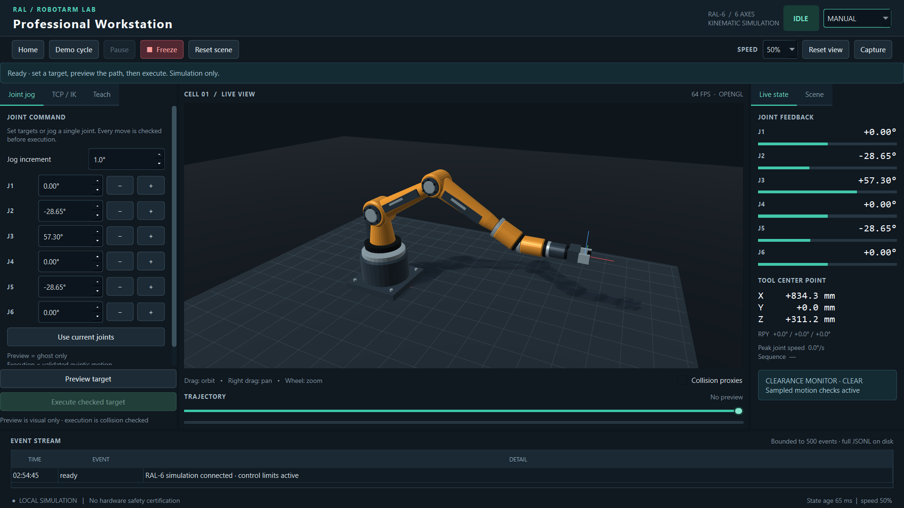
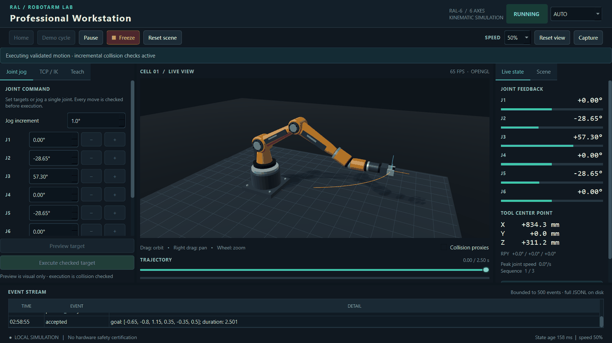

# RobotArm-Lab 0.2.0 — Professional Workstation

An inspectable six-axis robot control workstation with an original industrial-style
robot, responsive Qt HMI and independently verified robotics core.





**Kinematic simulation only.** The control core checks joint limits and sampled
collision clearance. This is not a hardware driver, torque controller, validated
industrial robot or functional-safety system. Visual shells and workbench are
cosmetic; the optional collision overlay shows the actual unchanged RAL-6 proxies.

[繁體中文操作指南](docs/USER_GUIDE.zh-TW.md) ·
[Architecture](docs/ARCHITECTURE.md) ·
[Measured validation](docs/WORKSTATION_VALIDATION.md) ·
[Licenses](THIRD_PARTY_NOTICES.md)

## Install and run on Windows 10 / Python 3.12

Use `E:\GitHubProjects\RobotArm-Lab`. The workstation has its own environment;
`.venv` from v0.1.1 is preserved. No activation or global package installation is needed.

```powershell
cd E:\GitHubProjects\RobotArm-Lab
powershell -File scripts\bootstrap.ps1
.\.venv-workstation\Scripts\python.exe -m robotarm_lab gui
```

The installer caches dependencies and temporary files inside the checkout on E:.
PyBullet 3.2.7 has no upstream Windows CPython 3.12 wheel. A fresh clone needs a
trusted compatible local wheel in `.cache/wheelhouse`, or Visual Studio 2022 Build
Tools with Desktop development with C++ and a Windows SDK. In the latter case,
explicitly run `powershell -File scripts\bootstrap.ps1 -AllowSourceBuild` once.
There is no silent source build or substituted PyBullet fork. Qt is installed from
pinned upstream PySide6-Essentials wheels. An OpenGL-capable desktop is required.
For a Windows software-rendering fallback, set `$env:QT_OPENGL = 'software'` before
launching; remove that variable to use the GPU again.

Equivalent manual installation:

```powershell
New-Item -ItemType Directory -Force .tmp, .cache\pip | Out-Null
$env:TEMP = "$PWD\.tmp"
$env:TMP = $env:TEMP
$env:PIP_CACHE_DIR = "$PWD\.cache\pip"
py -3.12 -m venv .venv-workstation
.\.venv-workstation\Scripts\python.exe -m pip install --only-binary=:all: packaging==26.3
.\.venv-workstation\Scripts\python.exe scripts\prepare_wheelhouse.py
.\.venv-workstation\Scripts\python.exe -m pip install --no-index --only-binary=:all: --find-links .cache\wheelhouse -r requirements-lock.txt
.\.venv-workstation\Scripts\python.exe -m pip install --no-deps --no-build-isolation -e .
.\.venv-workstation\Scripts\python.exe -m robotarm_lab gui --output outputs\gui
```

On Ubuntu / Python 3.11, install `python3.11-venv`, `libegl1`, `libgl1`,
`libxcb-cursor0`, `libxkbcommon-x11-0`, `libxcb-icccm4`, `libxcb-keysyms1`,
`libxcb-shape0`, `libxcb-xinerama0` and `libxcb-randr0`; then create
`.venv-workstation` with `python3.11 -m venv` and use `.venv-workstation/bin/python`
for the same installation commands. Linux 3.11 uses an upstream PyBullet wheel.
Headless GUI checks require `xvfb` and `xauth`; use `xvfb-run -a` before the Python
command. Tk is only needed for `gui-legacy` (`python3-tk` on Ubuntu).

## Operate the workstation

1. In **Joint jog**, enter six target angles in degrees. **Preview target** validates
   and draws a ghost/path without changing the actual robot. Scrub the timeline,
   then **Execute preview**. Editing the target or scene invalidates the preview.
2. **TCP / IK** uses world XYZ in millimetres and extrinsic XYZ roll/pitch/yaw in
   degrees. Preview solves IK and independently checks position, orientation and
   joint bounds before collision checking. Public Python APIs use SI/radians.
3. Jog `−/+` in Manual mode. **Home** plans a checked move. **Demo** selects Auto
   and plays three verified targets. **Pause / Resume** holds, then replans from rest.
   Speed override scales velocity and acceleration limits; changing it during
   motion holds and replans. This is not physical braking or jerk-limited blending.
4. **Freeze** cancels queued/planning motion and holds. **Reset** clears obstacles,
   preview and motion state and restores Home. Reset intentionally teleports only
   the simulation; saved teach points remain.
5. **Teach** captures the stationary pose to `outputs/gui/teach-points.json` using
   atomic replacement. Select a saved pose to preview/execute, delete it, or play
   the library in Auto mode. Restart with the same output directory to reload it.
6. **Scene** adds, edits, removes or clears world-frame boxes. Dimensions are full
   sizes in millimetres. The demo blocker demonstrates rejection. An obstacle
   inserted during motion triggers the original incremental clearance checks.
7. Drag left to orbit, right to pan, wheel to zoom, **Reset view** to restore the
   camera. **Capture** saves the actual Qt window. Live state shows joints, TCP,
   speed, progress and clearance; the bottom event table retains 500 entries.

Shortcuts: F5 Home, F6 Demo, Space Pause/Resume, Esc Freeze, F9 Reset.
The on-screen event history is bounded; complete events are appended to
`outputs/gui/session.jsonl`. A log-write failure enters FAULT. Fix storage and Reset.
A renderer failure holds motion; restart with a working graphics backend.

## Verify and reproduce

```powershell
.\.venv-workstation\Scripts\python.exe -m ruff check .
.\.venv-workstation\Scripts\python.exe -m ruff format --check .
.\.venv-workstation\Scripts\python.exe -m pytest --cov=robotarm_lab --junitxml=outputs\pytest.xml
.\.venv-workstation\Scripts\python.exe -m robotarm_lab benchmark --output outputs\benchmark
.\.venv-workstation\Scripts\python.exe scripts\hardening.py --output outputs\hardening
.\.venv-workstation\Scripts\python.exe scripts\workstation_verify.py --output outputs\workstation-verify
.\.venv-workstation\Scripts\python.exe scripts\workstation_soak.py --output outputs\workstation-soak
.\.venv-workstation\Scripts\python.exe scripts\workstation_capture.py --output outputs\workstation-capture
.\.venv-workstation\Scripts\python.exe scripts\workstation_visual_matrix.py --output outputs\workstation-scaling
.\.venv-workstation\Scripts\python.exe -m build --no-isolation
.\.venv-workstation\Scripts\python.exe scripts\clean_environment.py
```

Use a new output directory for each audit to preserve failures. The clean environment
script refuses an existing environment; repeat with `--environment .tmp/clean-repeat`.
GUI verifiers show real Qt windows, send QTest inputs and capture widgets/GL buffers.
The 600-second soak has a separate 30-second warm-up. Run performance checks alone
on an idle interactive desktop. CI tests correctness using software GL; local GPU
acceptance is governed by the unchanged `acceptance-v0.2.0.json` protocol.

The original `demo` CLI still exports PyBullet renders/GIFs. `gui-legacy` preserves
v0.1.1's Tk station. Historical reports and both earlier acceptance protocols remain
unchanged. See the validation report for exact current results, failed attempts and
untested items; generated code or a green unit test alone is not product acceptance.

## Engineering and extension

The independent NumPy FK, geometric-branch IK with bounded SciPy refinement,
quintic time parameterization and PyBullet collision oracle remain inspectable.
The single-owner control worker publishes immutable snapshots to the HMI and
Qt OpenGL renderer. Original procedural visual meshes use the same link frames;
100 seeded poses cross-check every link against PyBullet. See the architecture
for coordinate conventions and how to add a new robot without silently changing
its control geometry.

Project code, original meshes and captures: MIT. Qt/PySide/shiboken: LGPLv3,
dynamically installed with replacement permitted. No third-party robot CAD or
proprietary assets are included. Read all [third-party notices](THIRD_PARTY_NOTICES.md).

Development takes place on `codex/v0.2.0-workstation`. Stable `main` and the existing
v0.1.1 release remain separate. [Publishing instructions](docs/PUBLISHING.md) require
review of the branch, its evidence and actual remote checks before merge/release.
