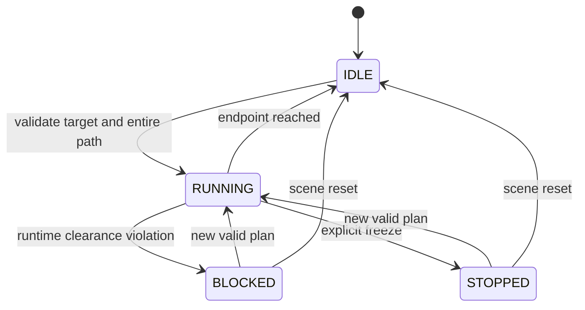

# Architecture and conventions

## Frames and original RAL-6 model

Right-handed world: Z up. SI units; joint angles in radians; public rotation matrices
map tool-frame vectors into world coordinates. SciPy/PyBullet quaternions use xyzw.
The GUI alone uses degrees and extrinsic XYZ Euler angles. TCP is a fixed frame
0.12 m along the last joint's X axis. The arm is an original educational morphology,
not a UR5/PUMA/ABB model or a dimensionally accurate commercial robot.

| Joint | Parent-frame origin (m) | Axis | Position limits (deg) |
|---|---|---|---|
| J1 | 0, 0, 0.18 | Z | ±170 |
| J2 | 0, 0, 0.16 | Y | ±110 |
| J3 | 0.32, 0, 0 | Y | ±135 |
| J4 | 0.28, 0, 0 | X | ±180 |
| J5 | 0.10, 0, 0 | Y | ±120 |
| J6 | 0.10, 0, 0 | X | ±180 |

Joint origins have identity orientation. With all q=0, TCP=[0.92,0,0.34] m and R=I.
Home is [0,-0.5,1,0,-0.5,0] rad. The URDF contains simple, inspectable boxes; its
nominal masses/inertias are placeholders, not a validated dynamics model.

## Mathematics

FK uses `T = product(Trans(origin_i) Rot(axis_i,q_i)) Trans(tool)`.
Rodrigues rotation is implemented directly as `I + sin(q)K + (1-cos(q))K²`.
The model constants and generated URDF are separate representations; random FK tests
would expose transform order, axis, TCP-offset and COM/frame mistakes.

IK minimizes `[p(q)-p_target, 0.3 log(R_target R(q)^T)]` with box constraints.
Finite-difference Jacobians and trust-region reflective least squares come from SciPy.
The 0.3 m/rad weight balances residual units; acceptance uses **unweighted** errors.
Initial guess, Home, target-bearing elbow/wrist branches, then seeded random restarts
are tried in that order. Results are
accepted only within position and SO(3) angular tolerances, including near singularities.
An outer sphere of radius 1.09 m around J1 provides a fast conservative reach bound.

For rest-to-rest motion, `s(u)=10u³-15u⁴+6u⁵`, with `u=t/T`.
Since `max|s'|=15/8` and `max|s''|=10 sqrt(3)/3`, the synchronized duration is
`max_i(1.875 |dq_i|/vmax_i, sqrt(5.773502692 |dq_i|/amax_i), control_dt)`.
No intermediate waypoints or obstacle avoidance search are implied: a blocked joint-space
line is rejected. All accepted motion starts from rest; commands during execution are busy.
Consecutive completed motions are C2 at the join, but jerk is not bounded.

## Command transaction and state

A rejected request does not replace the active trajectory or mutate the simulated pose.
Collision queries restore the previous joint state in a `finally` block. Each World
owns a separate PyBullet DIRECT client; callers must not access one World concurrently.
User controls go through Controller, while low-level World.set_q is for initialization,
model validation and explicit reset. Runtime rechecks cover the incremental geometric
segment even if the time step changes. Obstacles inserted on the current arm can already
overlap it; execution freezes rather than claiming to prevent arbitrary scene edits.

## Extension boundaries

Add new planners behind `plan` and `validate_path`; use the existing FK and collision
oracle to validate them. Add hardware support as a distinct feedback-controlled adapter
with measured joint state, following error, braking and a separately engineered safety
system. Never substitute a hardware device for World.set_q.

Unit tests cover mathematical identities and rejection invariants; integration tests
compare the independent geometry and exercise full commands; experiments retain every
fixed-seed case and latency. Settings are immutable validated dataclasses. Arrays in
accepted trajectories and poses are read-only to prevent accidental post-validation edits.
