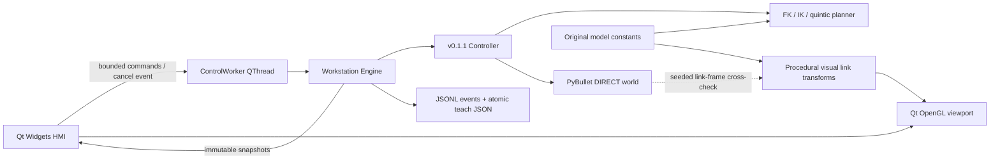
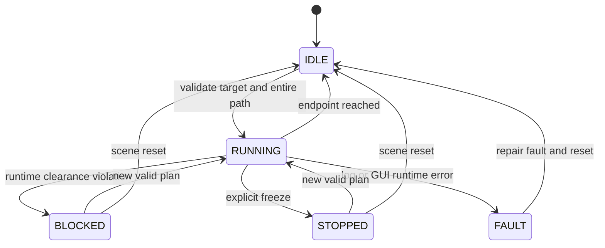

# Architecture and conventions

## v0.2.0 workstation layers

The control thread exclusively owns its Engine, Controller and PyBullet client.
No widget or renderer accesses that client. Signals deliver frozen tuple snapshots
at approximately 30 Hz; a precise GUI timer requests rendering at 16 ms intervals.
The fixed-step control accumulator caps catch-up at 50 ms after delays, so wall time
can run slower than simulation time under load. This is not a real-time controller.

The bounded command queue holds 32 requests; Freeze has a separate cancellation
event and clears queued commands. Path sampling checks cancellation between samples.
IK remains the original bounded solver, so cancellation may wait for an IK attempt.
Window close requests cancellation and waits asynchronously for the owner to close
the simulation. No forced thread termination or concurrent world destruction occurs.

Command acknowledgement measures submission to worker acceptance delivered back to
the GUI event loop. Completion latency is separately measured and includes planning
and collision validation; it is not presented as acknowledgement latency. A PLANNING
snapshot and immediate request notice give visible feedback while computation runs.

Preview stores a trajectory, its start pose and scene revision. Ghost scrubbing
does not change the authoritative pose. Execute rechecks the start/revision and
the original collision oracle. Target, speed and obstacle changes invalidate preview.
Repeated pending motion requests are guarded in the HMI; the core also rejects busy
commands. Manual enables jog; Auto enables library sequences. Each sequence segment
is independently planned and checked before execution, with no unchecked blending.

Pause/Freeze are kinematic holds. Resume and active speed changes plan from rest.
The immutable core preserves limits and sampled collision semantics. Reset restores
Home and clears obstacles; it deliberately resets simulated state rather than planning
a recovery motion. Log I/O failure enters FAULT and requires storage repair plus Reset.

The visual model uses original lathed profiles, cylinders, boxes and bolt instances.
Qt-owned VAOs, buffers and shader functions avoid mismatched OpenGL DLL contexts on
Windows. Both NVIDIA 3.3 core and Qt Mesa 3.0 software contexts were exercised during
development. Normals use inverse-transpose matrices. Shadows are planar projections,
not a physically based shadow map. Camera transforms are independent of robot state.

The decorative shells, fingers and bench do not define collision or dynamics.
The overlay draws the actual URDF proxies, which may be smaller than a shell.
There is no claim of visual-surface clearance. A new robot must supply matching
model constants, URDF and FK/IK assumptions and pass every link-frame/limit test.

Memory limits: 500 event rows, 2048 motion-trail points, 100 persisted teach poses;
the baseline world permits at most 128 obstacles/distinct cached shapes. Logs on disk
are append-only and unbounded over time. Clear/reset creates no unrestricted history.
The full verifier, source digest, screenshots and soak samples are retained as evidence.

## Frames and original RAL-6 model

Right-handed world: Z up. SI units; joint angles in radians; public rotation matrices
map tool-frame vectors into world coordinates. SciPy/PyBullet quaternions use xyzw.
The GUI alone uses degrees and extrinsic XYZ Euler angles. TCP is a fixed frame
0.12 m along the last joint's X axis. The arm is an original educational morphology,
not a UR5/PUMA/ABB model or a dimensionally accurate commercial robot.

| Joint | Parent-frame origin (m) | Axis | Position limits (deg) |
|---|---|---|---|
| J1 | 0, 0, 0.18 | Z | ±170 |
| J2 | 0, 0, 0.16 | Y | ±110 |
| J3 | 0.32, 0, 0 | Y | ±135 |
| J4 | 0.28, 0, 0 | X | ±180 |
| J5 | 0.10, 0, 0 | Y | ±120 |
| J6 | 0.10, 0, 0 | X | ±180 |

Joint origins have identity orientation. With all q=0, TCP=[0.92,0,0.34] m and R=I.
Home is [0,-0.5,1,0,-0.5,0] rad. The URDF contains simple, inspectable boxes; its
nominal masses/inertias are placeholders, not a validated dynamics model.

## Mathematics

FK uses `T = product(Trans(origin_i) Rot(axis_i,q_i)) Trans(tool)`.
Rodrigues rotation is implemented directly as `I + sin(q)K + (1-cos(q))K²`.
The model constants and generated URDF are separate representations; random FK tests
would expose transform order, axis, TCP-offset and COM/frame mistakes.

IK minimizes `[p(q)-p_target, 0.3 log(R_target R(q)^T)]` with box constraints.
In v0.1.1, analytic seeds use the spherical wrist center
`w = p_target - 0.22 R_target[:,0]`. Relative to the shoulder at [0,0,0.34],
the two-link lengths are 0.32 and 0.38 m. The cosine law produces both elbow branches;
signed radial distance covers both shoulder headings. Decomposing the remaining rotation
as intrinsic XYX yields both wrist branches. A candidate is only a seed: all accepted
results still pass unweighted FK errors, joint bounds and simulator pose validation.
The necessary wrist-center reach annulus is [0.06,0.70] m with tolerance-aware boundaries.
This model-specific construction must be updated when geometry changes.
Finite-difference Jacobians and trust-region reflective least squares come from SciPy.
The 0.3 m/rad weight balances residual units; acceptance uses **unweighted** errors.
Initial guess, analytic shoulder/elbow/wrist branches, Home, coarse geometric branches,
then seeded random restarts
are tried in that order. Results are
accepted only within position and SO(3) angular tolerances, including near singularities.
An outer sphere of radius 1.09 m around J1 provides a fast conservative reach bound.

For rest-to-rest motion, `s(u)=10u³-15u⁴+6u⁵`, with `u=t/T`.
Since `max|s'|=15/8` and `max|s''|=10 sqrt(3)/3`, the synchronized duration is
`max_i(1.875 |dq_i|/vmax_i, sqrt(5.773502692 |dq_i|/amax_i), control_dt)`.
No intermediate waypoints or obstacle avoidance search are implied: a blocked joint-space
line is rejected. All accepted motion starts from rest; commands during execution are busy.
Consecutive completed motions are C2 at the join, but jerk is not bounded.

## Command transaction and state

A rejected request does not replace the active trajectory or mutate the simulated pose.
Collision queries restore the previous joint state in a `finally` block. Each World
owns a separate PyBullet DIRECT client; callers must not access one World concurrently.
User controls go through Controller, while low-level World.set_q is for initialization,
model validation and explicit reset. Runtime rechecks cover the incremental geometric
segment even if the time step changes. Obstacles inserted on the current arm can already
overlap it; execution freezes rather than claiming to prevent arbitrary scene edits.

v0.1.1 validates collision step [1e-6,0.02] rad and computes the sample budget before
division/allocation. More than 10,000 samples is a rejected command; accepted paths
use an O(1)-storage iterator with exact endpoints. The sampler never changes resolution
to fit a budget. Distinct cached box geometries and active boxes each have a 128-item
limit; explicit reset rebuilds the native scene. Event-log I/O errors freeze in FAULT.

## Extension boundaries

Add new planners behind `plan` and `validate_path`; use the existing FK and collision
oracle to validate them. Add hardware support as a distinct feedback-controlled adapter
with measured joint state, following error, braking and a separately engineered safety
system. Never substitute a hardware device for World.set_q.

Unit tests cover mathematical identities and rejection invariants; integration tests
compare the independent geometry and exercise full commands; experiments retain every
fixed-seed case and latency. Settings are immutable validated dataclasses. Arrays in
accepted trajectories and poses are read-only to prevent accidental post-validation edits.
